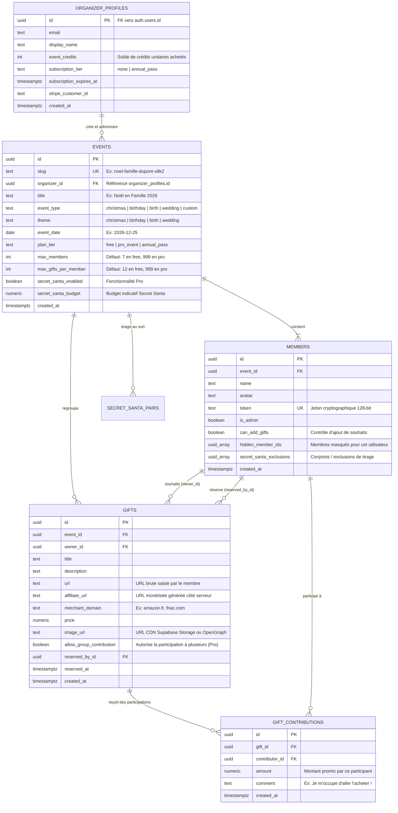
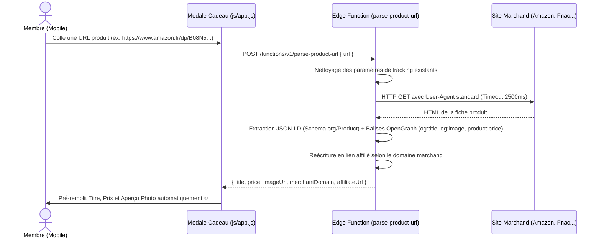
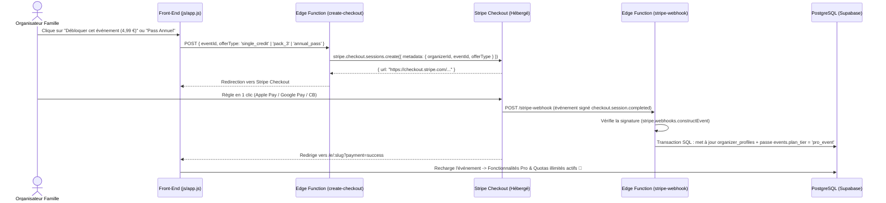

# 🏗️ Architecture Technique — Transformation SaaS Multi-Événements & Monétisation

> **Objectif du document** : Spécifier l'architecture technique complète permettant de faire évoluer l'application actuelle (MVP mono-famille statique) vers une plateforme SaaS multi-locataires (*multi-tenant*), sécurisée côté serveur, équipée d'un moteur d'affiliation e-commerce automatique et d'un système de monétisation Freemium (Crédits d'Événement & Abonnement Annuel via Stripe).

---

## 1. Audit Technique de l'Existant & Verrous à Lever

L'application actuelle repose sur une stack légère et performante (**Vanilla JS + Tailwind CSS + Supabase PostgreSQL**) parfaitement adaptée à un usage familial privé, mais comportant **5 verrous techniques bloquants** pour une distribution publique :

| # | Verrou identifié dans le code actuel | Localisation | Risque en production publique (SaaS) | Solution d'architecture retenue |
| :- | :--- | :--- | :--- | :--- |
| **1** | **Absence d'isolation Multi-Tenant** | [sql/schema.sql](sql/schema.sql#L13-L45) | Les tables `public.members` et `public.gifts` n'ont pas de clé `event_id`. Toutes les familles inscrites partageraient la même liste de membres et de cadeaux. | Introduction des tables `organizer_profiles` et `events`, et ajout de `event_id` sur toutes les entités enfants. |
| **2** | **Politiques RLS permissives (`USING (true)`)** | [sql/schema.sql](sql/schema.sql#L66-L103) | Le rôle public `anon` a le droit de faire `SELECT`, `INSERT`, `UPDATE`, `DELETE` sur l'intégralité de la base avec la clé publique exposée dans [js/config.js](js/config.js#L1-L5). | Révocation des accès directs aux tables pour `anon` et passage par des **fonctions RPC PostgreSQL (`SECURITY DEFINER`)** validant le jeton du membre appelant. |
| **3** | **Règle Anti-Spoiler exécutée côté navigateur** | `applyAntiSpoiler` dans [js/db.js](js/db.js#L298-L353) | `getGifts` dans [js/db.js](js/db.js#L710-L725) exécute `.from('gifts').select('*')`. La colonne `reserved_by_id` transite en clair sur le réseau avant d'être masquée en JS. Un utilisateur curieux ouvrant l'onglet Réseau voit qui a réservé ses cadeaux. | Masquage SQL strict dans la fonction RPC : `CASE WHEN g.owner_id = v_member.id THEN NULL ELSE g.reserved_by_id END`. |
| **4** | **Faible entropie des tokens de connexion** | `generateToken` dans [js/db.js](js/db.js#L430-L443) | Format actuel `prenom-4hex` (ex. `marie-8f2a`), soit seulement $16^4 = 65\,536$ combinaisons par prénom. Un script automatisé peut deviner les liens d'autres familles en quelques secondes. | Jetons cryptographiques de 128 bits (`prenom-` + 22 caractères Base62 générés via `crypto.getRandomValues` ou `gen_random_bytes(16)`). |
| **5** | **Stockage des photos en Base64 dans PostgreSQL** | `compressImageFile` dans [js/db.js](js/db.js#L1063-L1080) | Chaque photo uploadée (~100 à 200 Ko en texte Base64) est stockée dans la colonne `gifts.image_url`. À 10 000 cadeaux, la table atteint ~1,5 Go et chaque chargement de liste télécharge plusieurs mégaoctets de JSON. | Upload binaire (WebP/JPEG) vers un bucket CDN **Supabase Storage** (`gift-images`) et stockage de l'URL publique uniquement. |

---

## 2. Vue d'Ensemble de l'Architecture Cible

Nous conservons la philosophie **Zero-Build / Serverless** qui fait la rapidité et la gratuité d'hébergement du projet, en déportant uniquement l'intelligence critique (sécurité, scraping URL, affiliation, paiement Stripe) dans **PostgreSQL (RPC)** et **Supabase Edge Functions (Deno / TypeScript)**.

```mermaid
graph TB
    subgraph Client ["📱 Front-End PWA (Cloudflare Pages / GitHub Pages)"]
        LP["Landing Page & Onboarding (/)"]
        APP["SPA Événement (/e/:slug?token=...)"]
        SW["Service Worker & Web Share API"]
    end

    subgraph Supabase ["⚡ Backend Serverless (Supabase EU-West)"]
        AUTH["Supabase Auth (Organisateurs : Google / Magic Email)"]
        DB[("PostgreSQL 15+\nTables + Triggers Quotas\nFonctions RPC Anti-Spoiler")]
        STORAGE["Supabase Storage CDN\nBucket: gift-images"]
        
        subgraph EdgeFunctions ["Supabase Edge Functions (Deno)"]
            EF_PARSE["parse-product-url\n(Scraping OpenGraph + Affiliation)"]
            EF_GO["redirect-affiliate (/go/:giftId)\n(Tracking clics & Redirection)"]
            EF_STRIPE["create-checkout-session\n(Achat Crédits / Pass Annuel)"]
            EF_WEBHOOK["stripe-webhook\n(Déblocage instantané Quotas)"]
        end
    end

    subgraph External ["🌐 Services Tiers & Monétisation"]
        MERCHANTS["Sites Marchands\n(Amazon, Fnac, Cultura, Decathlon...)"]
        STRIPE["Stripe Checkout\n(Apple Pay, Google Pay, CB)"]
        RESEND["Resend API\n(Emails transactionnels)"]
    end

    LP -->|Création compte / événement| AUTH
    APP -->|Appels RPC avec token membre| DB
    APP -->|Upload photo WebP/JPEG| STORAGE
    APP -->|Collage URL produit| EF_PARSE
    APP -->|Clic 'Voir en boutique'| EF_GO
    APP -->|Débloquer Crédits / Pass| EF_STRIPE

    EF_PARSE -->|Fetch HTML Meta / JSON-LD| MERCHANTS
    EF_GO -->|Redirection 302 taguée (?tag=...)| MERCHANTS
    EF_STRIPE -->|Session de paiement| STRIPE
    STRIPE -->|Webhook signé (checkout.session.completed)| EF_WEBHOOK
    EF_WEBHOOK -->|Crédite profil / Débloque event| DB
    EF_WEBHOOK -->|Confirmation achat| RESEND
```

---

## 3. Modèle de Données PostgreSQL Cible (Multi-Tenant & Multi-Événements)

### 3.1 Diagramme Entité-Relation (ERD)



### 3.2 Spécification SQL des Nouvelles Tables et Quotas

Le quota gratuit est calibré à **`max_gifts_per_member = 12`** et **`max_members = 7`** par défaut afin de maximiser le volume de liens affiliés sur les comptes gratuits :

```sql
-- 1. Profils Organisateurs (liés à Supabase Auth)
CREATE TABLE IF NOT EXISTS public.organizer_profiles (
    id UUID PRIMARY KEY REFERENCES auth.users(id) ON DELETE CASCADE,
    email TEXT NOT NULL,
    display_name TEXT,
    event_credits INTEGER NOT NULL DEFAULT 0 CHECK (event_credits >= 0),
    subscription_tier TEXT NOT NULL DEFAULT 'none' CHECK (subscription_tier IN ('none', 'annual_pass')),
    subscription_expires_at TIMESTAMPTZ,
    stripe_customer_id TEXT UNIQUE,
    created_at TIMESTAMPTZ NOT NULL DEFAULT now()
);

-- 2. Table des Événements (Multi-Tenancy & Multi-Saisons)
CREATE TABLE IF NOT EXISTS public.events (
    id UUID PRIMARY KEY DEFAULT gen_random_uuid(),
    slug TEXT UNIQUE NOT NULL,
    organizer_id UUID REFERENCES public.organizer_profiles(id) ON DELETE SET NULL,
    title TEXT NOT NULL,
    event_type TEXT NOT NULL DEFAULT 'christmas'
        CHECK (event_type IN ('christmas', 'birthday', 'birth', 'wedding', 'custom')),
    theme TEXT NOT NULL DEFAULT 'christmas'
        CHECK (theme IN ('christmas', 'birthday', 'birth', 'wedding')),
    event_date DATE,
    plan_tier TEXT NOT NULL DEFAULT 'free'
        CHECK (plan_tier IN ('free', 'pro_event', 'annual_pass')),
    max_members INTEGER NOT NULL DEFAULT 7,
    max_gifts_per_member INTEGER NOT NULL DEFAULT 12,
    secret_santa_enabled BOOLEAN NOT NULL DEFAULT FALSE,
    secret_santa_budget NUMERIC(10, 2),
    created_at TIMESTAMPTZ NOT NULL DEFAULT now()
);

-- 3. Évolution des tables `members` et `gifts`
ALTER TABLE public.members
    ADD COLUMN IF NOT EXISTS event_id UUID REFERENCES public.events(id) ON DELETE CASCADE,
    ADD COLUMN IF NOT EXISTS can_add_gifts BOOLEAN DEFAULT TRUE,
    ADD COLUMN IF NOT EXISTS hidden_member_ids UUID[] DEFAULT '{}',
    ADD COLUMN IF NOT EXISTS secret_santa_exclusions UUID[] DEFAULT '{}';

ALTER TABLE public.gifts
    ADD COLUMN IF NOT EXISTS event_id UUID REFERENCES public.events(id) ON DELETE CASCADE,
    ADD COLUMN IF NOT EXISTS affiliate_url TEXT,
    ADD COLUMN IF NOT EXISTS merchant_domain TEXT,
    ADD COLUMN IF NOT EXISTS allow_group_contribution BOOLEAN DEFAULT FALSE;

CREATE INDEX IF NOT EXISTS idx_members_event_id ON public.members(event_id);
CREATE INDEX IF NOT EXISTS idx_gifts_event_id ON public.gifts(event_id);
CREATE INDEX IF NOT EXISTS idx_events_slug ON public.events(slug);
```

### 3.3 Trigger SQL de Vérification des Quotas Freemium

Plutôt que de vérifier les quotas uniquement en JavaScript (contournable), PostgreSQL garantit le respect des limites du plan :

```sql
CREATE OR REPLACE FUNCTION public.enforce_event_gift_quota()
RETURNS TRIGGER
LANGUAGE plpgsql
AS $$
DECLARE
    v_max_gifts INTEGER;
    v_current_count INTEGER;
    v_can_add BOOLEAN;
BEGIN
    -- 1. Vérifier que le membre a le droit d'ajouter des cadeaux (contrôle Admin/Parental)
    SELECT can_add_gifts INTO v_can_add
    FROM public.members
    WHERE id = NEW.owner_id AND event_id = NEW.event_id;

    IF v_can_add IS FALSE THEN
        RAISE EXCEPTION 'Vous n''êtes pas autorisé à ajouter des souhaits sur cette liste.';
    END IF;

    -- 2. Vérifier le plafond de souhaits par membre selon le plan de l'événement
    SELECT max_gifts_per_member INTO v_max_gifts
    FROM public.events
    WHERE id = NEW.event_id;

    SELECT COUNT(*) INTO v_current_count
    FROM public.gifts
    WHERE event_id = NEW.event_id AND owner_id = NEW.owner_id;

    IF v_current_count >= COALESCE(v_max_gifts, 12) THEN
        RAISE EXCEPTION 'QUOTA_GIFTS_REACHED: Limite de % souhaits par membre atteinte pour l''offre gratuite. Débloquez le Pass Événement pour ajouter des souhaits en illimité !', v_max_gifts;
    END IF;

    RETURN NEW;
END;
$$;

DROP TRIGGER IF EXISTS trg_enforce_gift_quota ON public.gifts;
CREATE TRIGGER trg_enforce_gift_quota
    BEFORE INSERT ON public.gifts
    FOR EACH ROW
    EXECUTE FUNCTION public.enforce_event_gift_quota();
```

---

## 4. Sécurité, Authentification Hybride & Anti-Spoiler Serveur

### 4.1 Authentification à Deux Niveaux (Zéro Friction sur WhatsApp)

1. **Niveau Organisateur (Créateur de la famille)** :
   - Utilise **Supabase Auth** (Connexion Google en 1 clic ou Magic Link par email).
   - Permet de retrouver tous ses événements (`Noël 2026`, `Anniversaire Léo`, etc.), de consulter son solde de Crédits Événement et de gérer son abonnement Stripe.
2. **Niveau Participant Invité (Membres de la famille)** :
   - **Aucun compte ni mot de passe requis** : on conserve l'expérience actuelle par lien magique partagé sur WhatsApp (`/e/noel-dupont?token=marie-7f9k2m...`).
   - Le token est généré avec une entropie cryptographique d'au moins **128 bits** :
     ```javascript
     // Remplacement dans js/db.js
     generateSecureToken(name) {
       const slug = this.slugifyName(name);
       const bytes = new Uint8Array(16); // 128 bits d'entropie
       window.crypto.getRandomValues(bytes);
       const alphabet = '0123456789abcdefghijklmnopqrstuvwxyzABCDEFGHIJKLMNOPQRSTUVWXYZ';
       let randomPart = '';
       for (let i = 0; i < bytes.length; i++) {
         randomPart += alphabet[bytes[i] % alphabet.length];
       }
       return `${slug}-${randomPart}`;
     }
     ```

### 4.2 Fonction RPC PostgreSQL Anti-Spoiler & Isolation Multi-Tenant

Pour empêcher toute lecture inter-familles et toute fuite de `reserved_by_id` dans les outils de développement du navigateur (onglet Réseau), l'accès direct `SELECT` à la table `public.gifts` est fermé au rôle `anon`. Le client appelle la fonction RPC `get_event_gifts_secure(p_member_token TEXT)` :

```sql
CREATE OR REPLACE FUNCTION public.get_event_gifts_secure(p_member_token TEXT)
RETURNS TABLE (
    id UUID,
    event_id UUID,
    owner_id UUID,
    owner_name TEXT,
    owner_avatar TEXT,
    title TEXT,
    description TEXT,
    url TEXT,
    affiliate_url TEXT,
    merchant_domain TEXT,
    price NUMERIC,
    image_url TEXT,
    created_at TIMESTAMPTZ,
    is_own_gift BOOLEAN,
    reserved_by_id UUID,
    reserved_by_name TEXT,
    reserved_by_avatar TEXT,
    reserved_at TIMESTAMPTZ
)
LANGUAGE plpgsql
SECURITY DEFINER
SET search_path = public
AS $$
DECLARE
    v_caller public.members%ROWTYPE;
BEGIN
    -- 1. Identifier le membre appelant via son token secret
    SELECT * INTO v_caller
    FROM public.members m
    WHERE lower(m.token) = lower(trim(p_member_token))
    LIMIT 1;

    IF NOT FOUND THEN
        RAISE EXCEPTION 'AUTH_INVALID_TOKEN: Lien magique invalide ou expiré.';
    END IF;

    -- 2. Retourner uniquement les cadeaux du même événement :
    --    - Exclut les membres figurant dans `v_caller.hidden_member_ids`
    --    - Force `reserved_by_id`, `reserved_by_name`, `reserved_at` à NULL si `g.owner_id = v_caller.id` (Anti-Spoiler Serveur)
    RETURN QUERY
    SELECT
        g.id,
        g.event_id,
        g.owner_id,
        owner_m.name AS owner_name,
        owner_m.avatar AS owner_avatar,
        g.title,
        g.description,
        g.url,
        COALESCE(g.affiliate_url, g.url) AS affiliate_url,
        g.merchant_domain,
        g.price,
        g.image_url,
        g.created_at,
        (g.owner_id = v_caller.id) AS is_own_gift,
        CASE WHEN g.owner_id = v_caller.id THEN NULL ELSE g.reserved_by_id END AS reserved_by_id,
        CASE WHEN g.owner_id = v_caller.id THEN NULL ELSE reserver_m.name END AS reserved_by_name,
        CASE WHEN g.owner_id = v_caller.id THEN NULL ELSE reserver_m.avatar END AS reserved_by_avatar,
        CASE WHEN g.owner_id = v_caller.id THEN NULL ELSE g.reserved_at END AS reserved_at
    FROM public.gifts g
    INNER JOIN public.members owner_m ON owner_m.id = g.owner_id
    LEFT JOIN public.members reserver_m ON reserver_m.id = g.reserved_by_id
    WHERE g.event_id = v_caller.event_id
      AND NOT (g.owner_id = ANY(COALESCE(v_caller.hidden_member_ids, '{}')))
    ORDER BY g.created_at DESC;
END;
$$;
```

---

## 5. Moteur d'Affiliation & Extraction Automatique d'URL (Edge Functions)

### 5.1 Pourquoi l'Auto-Fill est le multiplicateur n°1 des revenus d'affiliation
Sur smartphone, copier-coller séparément le titre d'un produit, son prix et chercher une image est fastidieux : sans aide, beaucoup d'utilisateurs n'écrivent qu'un texte libre (*« Un pull bleu taille M »*), ce qui génère **0 € d'affiliation**.
Avec l'auto-remplissage par URL :
1. L'utilisateur colle uniquement le lien Amazon / Fnac / Cultura dans le premier champ de la modale (`openGiftModal` dans [js/app.js](js/app.js#L1311-L1360)).
2. La Supabase Edge Function `parse-product-url` extrait instantanément le titre, la photo HD et le prix.
3. En même temps, elle génère l'URL affiliée (`affiliate_url`).

### 5.2 Flux de l'Edge Function `parse-product-url`



### 5.3 Règles de Réécriture Affiliée & Redirecteur Dynamique (`/go/:giftId`)

Plutôt que de coder en dur les liens affiliés uniquement au moment de la création du cadeau, nous combinons **deux mécanismes** :
1. **Réécriture directe en base (`gifts.affiliate_url`)** pour un affichage propre.
2. **Route de redirection dynamique (`/functions/v1/go?gift_id=...`)** :
   - Si vous rejoignez un nouveau programme partenaire (ex. Fnac via Awin) **après** que vos utilisateurs ont déjà ajouté 5 000 liens Fnac dans leurs listes, le redirecteur transforme les liens à la volée au moment du clic de l'acheteur !
   - Permet également d'incrémenter un compteur anonymisé `outbound_clicks` pour connaître vos marchands les plus rentables.

| Marchand détecté (`merchant_domain`) | Réseau d'affiliation | Transformation appliquée | Taux de commission indicatif |
| :--- | :--- | :--- | :---: |
| `amazon.fr`, `amzn.eu`, `amzn.to` | **Amazon Partenaires** | Ajout / remplacement du paramètre `?tag=votreid-21&linkCode=ll1` | **3 % à 10 %** *(sur tout le panier mis en commande sous 24h)* |
| `fnac.com`, `darty.com`, `cultura.com`, `natureetdecouvertes.com` | **Awin** | Encapsulation en DeepLink Awin : `https://www.awin1.com/cread.php?awinmid=<MID>&awinaffid=<AFFID>&ued=<URL_ENCODEE>` | **3 % à 7 %** |
| `decathlon.fr`, `cdiscount.com`, `boulanger.com`, `maisonsdumonde.com` | **Effinity / Tradedoubler / Kwanko** | Encapsulation via l'URL de tracking du réseau correspondant | **3 % à 8 %** |
| Autres domaines non partenaires | Direct | Redirection transparente vers `gifts.url` sans modification | 0 % |

---

## 6. Architecture de Monétisation Freemium (Crédits & Abonnement Stripe)

### 6.1 Logique Métier des Crédits & Abonnements

- **Achat à l'acte (« Crédit Événement Pro » — 4,99 € ou Pack 3 Crédits à 9,99 €)** :
  - Incrémente `organizer_profiles.event_credits`.
  - L'organisateur peut consommer 1 crédit sur son événement actuel (`events.plan_tier = 'pro_event'`, `max_members = 999`, `max_gifts_per_member = 999`, `secret_santa_enabled = true`).
- **Abonnement (« Pass Famille Annuel » — 9,99 €/an)** :
  - Passe `organizer_profiles.subscription_tier = 'annual_pass'`.
  - Tous les événements créés par cet organisateur passent automatiquement en `plan_tier = 'annual_pass'` sans consommer de crédit unitaire.

### 6.2 Flux de Paiement Sécurisé Stripe Checkout & Webhook



---

## 7. Stockage Images, Thèmes Multi-Saisons & PWA

### 7.1 Remplacement du Base64 par Supabase Storage (`gift-images`)
Dans [js/db.js](js/db.js#L1063-L1080), la fonction actuelle `compressImageFile` utilise déjà un `<canvas>` HTML5 pour redimensionner la photo à `maxWidth = 800`.
L'évolution consiste à remplacer `canvas.toDataURL('image/jpeg', 0.78)` par `canvas.toBlob(..., 'image/webp', 0.80)` puis à téléverser ce Blob directement dans Supabase Storage :

```javascript
// Nouveau flux d'upload dans js/db.js
async uploadGiftImage(file, eventId) {
  const blob = await this.compressImageToBlob(file, 800, 0.80); // WebP ~60 Ko
  const filePath = `${eventId}/${crypto.randomUUID()}.webp`;

  const { error } = await _supabase.storage
    .from('gift-images')
    .upload(filePath, blob, { contentType: 'image/webp', upsert: false });

  if (error) throw new Error('Impossible de téléverser la photo.');

  const { data } = _supabase.storage.from('gift-images').getPublicUrl(filePath);
  return data.publicUrl; // URL CDN légère stockée dans gifts.image_url
}
```

### 7.2 Système de Thèmes CSS Multi-Événements (Utilisable toute l'année)
Pour permettre à l'application de servir à Noël tout en étant prête pour les anniversaires, listes de naissance ou mariages le reste de l'année, les couleurs configurées dans [index.html](index.html) et [css/styles.css](css/styles.css) sont abstraites en variables CSS sémantiques sur la balise `<html data-theme="...">` :

| Variable CSS Sémantique | Thème `christmas` (Défaut) | Thème `birthday` (Anniversaire) | Thème `birth` (Naissance) |
| :--- | :---: | :---: | :---: |
| `--color-brand-primary` | `#143628` *(Vert Sapin)* | `#312e81` *(Indigo Festif)* | `#3f624d` *(Vert Sauge doux)* |
| `--color-brand-accent` | `#c82829` *(Rouge Framboise)* | `#e11d48` *(Rose Corail)* | `#d97757` *(Terracotta doux)* |
| `--color-brand-highlight` | `#d4af37` *(Or de Noël)* | `#f59e0b` *(Jaune Ambre)* | `#eab308` *(Doré tendre)* |
| `--color-bg-surface` | `#fdfbf7` *(Crème chaud)* | `#fafaf9` *(Blanc perle)* | `#fcfaf5` *(Lin naturel)* |

### 7.3 Structure des Fichiers Cible du Dépôt

```text
.
├── index.html                              # Point d'entrée SPA (Landing Page + Vue Événement)
├── manifest.json                           # Manifeste PWA (installation mobile sur écran d'accueil)
├── sw.js                                   # Service Worker (cache shell statique)
├── suivi_de_projet.md                      # Feuille de route, Gantt, prérequis & modèle économique
├── architecture_technique.md               # Spécifications techniques SaaS (ce document)
├── css/
│   └── styles.css                          # Variables de thèmes (christmas, birthday, birth) & styles UI
├── js/
│   ├── config.js                           # URL Supabase, Anon Key & Constantes des plans/quotas
│   ├── db.js                               # Appels RPC sécurisés, Upload Storage & Auth hybride
│   └── app.js                              # Routage, Auto-fill URL, Modale Crédits/Pass, Secret Santa
├── sql/
│   ├── schema.sql                          # Schéma actuel V1 (Mono-famille)
│   └── migration_v2_saas.sql               # Migration vers Multi-Tenant, Quotas, RPC Anti-Spoiler
└── supabase/
    └── functions/
        ├── parse-product-url/index.ts      # Scraping OpenGraph/JSON-LD + Génération lien affilié
        ├── redirect-affiliate/index.ts     # Redirecteur /go/:giftId & compteur de clics sortants
        ├── create-checkout-session/index.ts# Création de session Stripe (Crédits / Pass Annuel)
        └── stripe-webhook/index.ts         # Réception webhook Stripe & déblocage des quotas
```

---

## 8. Stratégie de Migration Sans Coupure depuis la V1 Actuelle

Pour ne perdre aucune donnée de votre famille actuelle lors du passage à l'architecture V2 :
1. Le script de migration crée un premier événement par défaut dans `public.events` (`slug = 'noel-en-famille-2026'`, `plan_tier = 'pro_event'`).
2. Toutes les lignes existantes de `public.members` (y compris leurs colonnes `can_add_gifts` et `hidden_member_ids`) et de `public.gifts` sont automatiquement rattachées à cet `event_id` par défaut.
3. Les liens magiques existants (`?token=...`) continuent de fonctionner immédiatement, car la résolution du membre par `token` retrouve automatiquement l'événement auquel il appartient.
